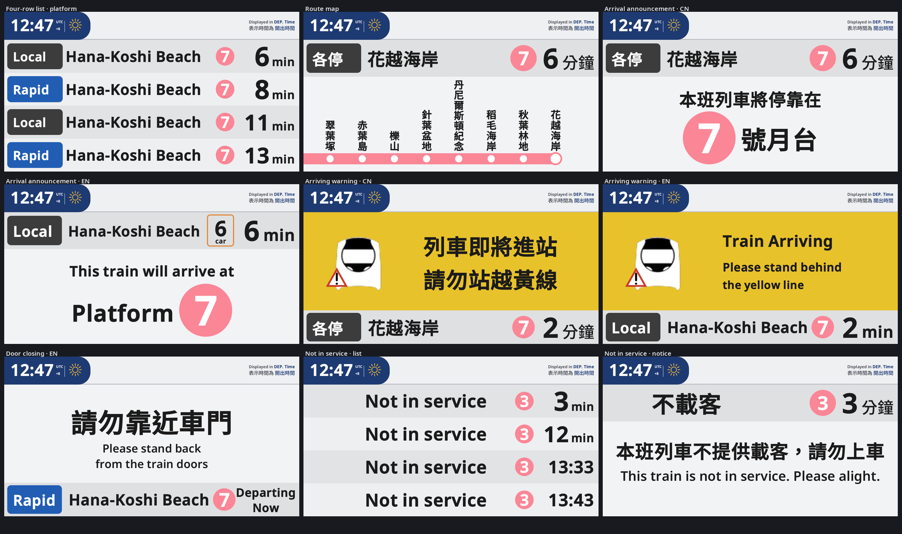

# HKR LCD PIDS (English)

A **JCM (Joban Client Mod) Scripted PIDS Preset** that recreates the **LCD PIDS** screens
seen on the Hana-Koshi Line platforms of the **LPS server**.

Original layout: **Forest_E233** · Recreation / code: **ChihayaAnonQWQ** · License: **MIT**.

This is the LCD-style display — light background, blue clock tab, large destination,
vertical station names and the route band — not the split-flap display.



## Features

| View | Trigger | Content |
| --- | --- | --- |
| Four-row list · platform | cycle 0–2s / 4–6s | 4 trains: service badge, destination, platform circle, minutes |
| Four-row list · formation | cycle 2–4s / 6–8s | 4 trains: service badge, destination, car-count box (4 car / 4 卡), minutes |
| Arrival announcement | cycle 8–14s (CN) / 14–20s (EN) | Large “本班列車將停靠在 4 號月台 / This train will arrive at Platform 4”; the header row alternates platform/formation every 2 s |
| Route map | when the train has arrived (Departing Now) | clock, service badge, destination, platform + ETA, vertical names of the stops after this station, route band and station dots |
| Arriving warning | next arrival ≤ 60 s | yellow panel, warning triangle, two warning lines, bottom info bar |
| Door closing | departure ≤ 10 s | “請勿靠近車門 / Please stand back from the train doors” + info bar |
| Empty | no arrivals | “沒有列車服務 / No Train Service” |

- Real local time + UTC offset; weather icon uses JCM's built-in textures (sunny / rainy / thunder) via `MinecraftClient.worldIsRaining()/worldIsThundering()`.
- CJK station names are stacked upright; Latin names are rotated 90° bottom-to-top.
- Scales to any PIDS size (133×72 LCD PIDS and 136×76 RV PIDS recommended).
- Content-signature based redraw: no `upload()` while nothing changes.

## Requirements

Minecraft 1.19.4–1.21, MTR 4.x, JCM 2.2+ (scripted PIDS support).

Install the zip into `resourcepacks/`, enable it, place a PIDS block and pick
**HKR LCD PIDS** in the PIDS preset menu.

## Service names (MTR side)

The script reads the **route number** first (falling back to the route name).
Write it as `中文|English`:

```
各停|Local     快速|Rapid     特急|Spec.press     準急|Semi Exp.
特快|Special Rapid     通快|Com.Rapid     急行|Ex.press
```

You can also put the service after `||` in the route name:
`花越线|Hana-Koshi Line||快速|Rapid`.

Built-in colours: 特急 `D32F2F`, 準急 `27AE60`, 特快 `453EA5`, 通快 `0E9E9E`,
急行 `E67E22`, 快速 `215DB3`, 各停 `3C3C3C`. Unknown services fall back to the MTR route colour.

## No travel times on the route map

The scripting API exposes no inter-station running times: `ArrivalResponse` only carries this
station's arrival/departure, `SimplifiedRoute` only station order, and `Platform.routes` is empty
on the client, so MTR's internal segment durations are unreachable. The route map therefore no
longer draws the time bubbles: it shows the route band (MTR route colour), station dots and the
vertical station names, plus the header's service/destination/platform/ETA.

## Configuration

All tunables live at the top of `assets/jsblock/scripts/hklcd.js`:
`SS`, `ARRIVING_WARN_MS`, `DOOR_CLOSING_MS`, `VIEW_PERIOD_MS`, `LANG_FORCE`, the `C_*`
palette, `SERVICE_OVERRIDE` (and the legacy `TRAVEL_PROFILES` table), and `HOME_PLATFORM_INDEX`
(the index of this PIDS's own platform in `getTargetPlatformIds()`; override it in-game by putting
`HOME=n` in a custom message (1-based; 0 = default), or `HOME=-1` to force the platform-arrival notice for testing).

## Verification (dev only)

`harness/` runs the real script in Rhino 1.9.1 with real Java AWT offscreen rendering,
plus a JCM API mock. 30+ scenarios cover all views, night/day, missing data, long names and
sizes from 40×20 to 272×152. `validate.py` performs static checks, renders every scenario
and samples the resulting pixels.

## License

MIT (see `LICENSE`). Third-party notes in `NOTICE.md`.
Reference screenshots were used only to reproduce the layout and palette; no assets from
the original resource pack are included. MTR, JCM and their bundled fonts belong to their
respective authors.
